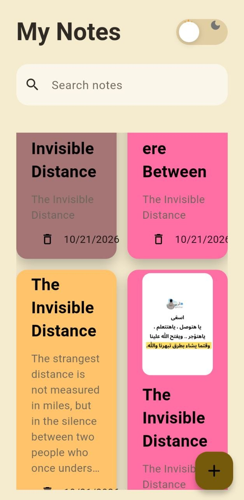
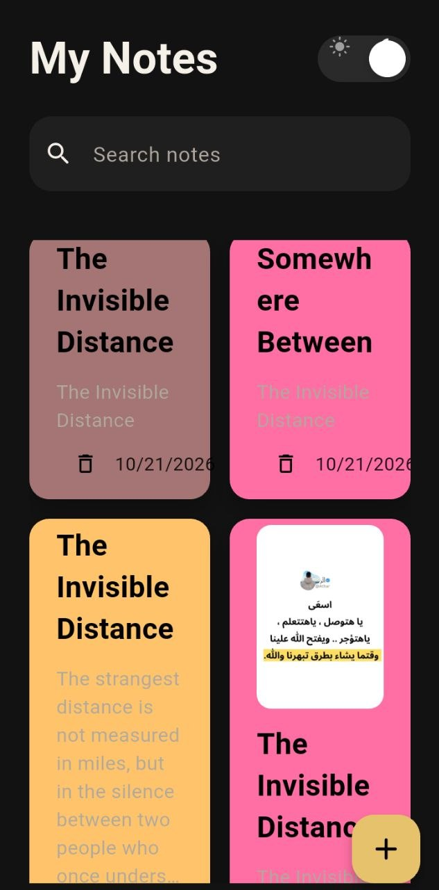
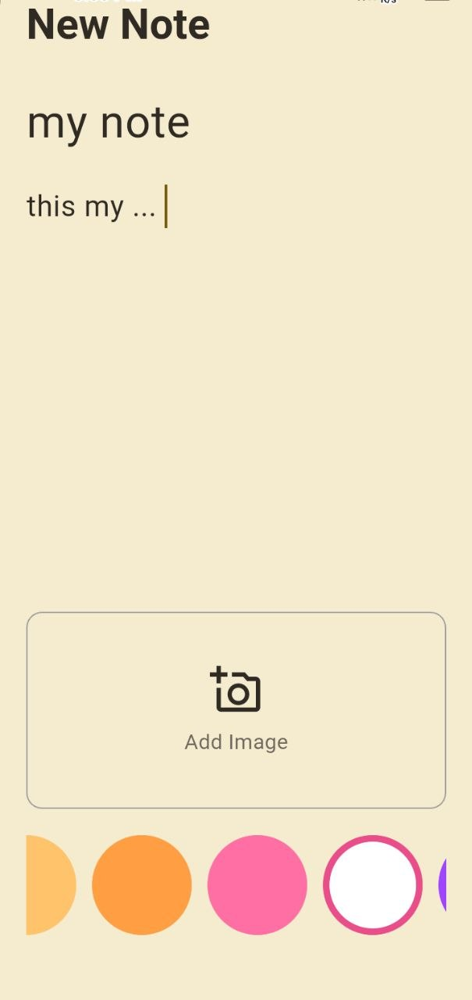
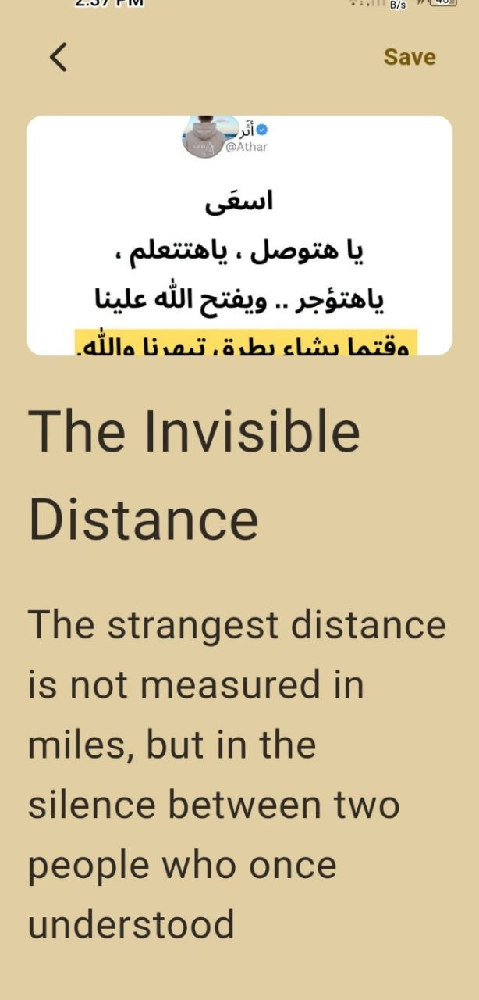
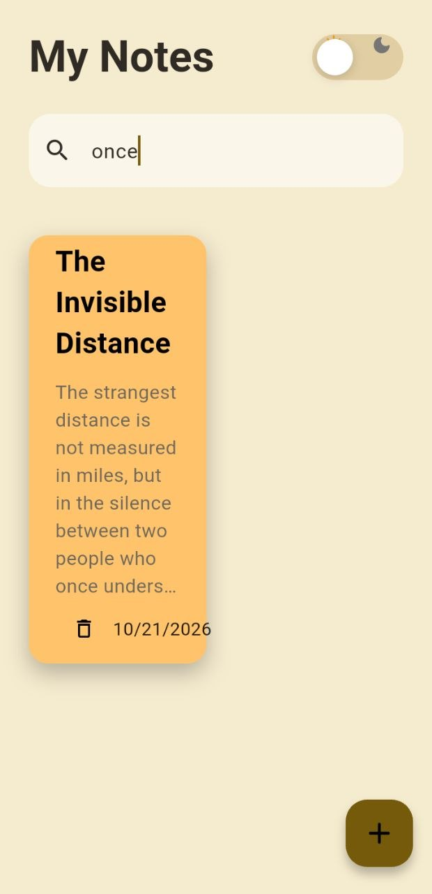

<div align="center">

# 📝 Note App

### A Modern, Offline-First Note-Taking App Built with Flutter

Capture your thoughts, organize your ideas, and keep your notes accessible anytime.

Create, edit, search, and personalize your notes with custom colors, image attachments, and a beautiful light and dark theme experience — all without requiring an internet connection.

**Built with Flutter · Dart · BLoC/Cubit · Hive**

</div>

---

## 📌 Table of Contents

* [About the Project](#-about-the-project)
* [Features](#-features)
* [Screenshots](#-screenshots)
* [Tech Stack](#-tech-stack)
* [Architecture and State Management](#-architecture-and-state-management)
* [Getting Started](#-getting-started)
* [Project Structure](#-project-structure)
* [Dependencies](#-dependencies)
* [Future Improvements](#-future-improvements)
* [Author](#-author)

---

## 📖 About the Project

**Note App** is a modern note-taking application developed with Flutter and Dart to provide a simple, fast, and convenient way to capture and organize everyday thoughts.

The application enables users to create, edit, delete, and search notes through an intuitive interface. Each note can be personalized with a custom background color and an optional image attachment, making it easier to organize information visually.

Built with an offline-first approach, the application uses **Hive** for local data persistence, allowing users to access their saved notes without an internet connection or an account.

### 🎯 Project Objectives

* **Offline-First Experience:** Store notes locally and make them accessible without network connectivity.
* **Efficient Note Management:** Create, update, delete, and search notes through a simple interface.
* **Personalized Organization:** Customize note colors and attach images to capture additional context.
* **Responsive State Management:** Use BLoC/Cubit to manage application state and separate responsibilities.
* **Consistent User Experience:** Provide Material 3 styling with dedicated light and dark themes.

---

## ✨ Features

### 📝 Note Management

* Create notes with a title and detailed content.
* Edit existing notes using a dedicated note editor.
* Validate required fields before saving.
* Display loading feedback during note creation.
* Automatically record note creation dates.

### 🔍 Search and Organization

* Search notes by title or content.
* Filter results instantly as the user types.
* Perform case-insensitive searches.
* Restore the complete note collection when the search field is cleared.
* Display notes in a two-column masonry grid.
* Choose from a palette of ten note colors.

### 🖼️ Image Attachments

* Select images from the device gallery.
* Preview selected images before saving.
* Display image previews inside note cards.
* View attached images when editing a note.

### 🎨 User Interface

* Modern Material 3 design.
* Custom light and dark themes.
* Animated theme-switching control.
* Colorful note cards with naturally sized layouts.
* Reusable UI components.
* Theme-aware system status bar and navigation bar styling.

### 💾 Offline Storage

* Persist notes locally using Hive.
* Access saved notes without an internet connection.
* Retain saved notes after restarting the application.
* Generate Hive model adapters using `build_runner`.

### ⚙️ State Management

* Manage note collections using Cubit.
* Handle note creation through loading, success, and failure states.
* Manage the application theme independently.
* Use `BlocObserver` to monitor state changes during development.

---
---

## 📱 Screenshots

Explore the application's interface, from browsing notes to creating, editing, and searching for them.

### 🏠 Home Screen

| Light Theme | Dark Theme |
|:---:|:---:|
|  |  |

### 📝 Create and Edit Notes

| Create Note | Edit Note |
|:---:|:---:|
|  |  |

### 🔍 Search Notes

<div align="center">
  
</div>

---
## 🛠️ Tech Stack

| Technology                    | Purpose                                |
| ----------------------------- | -------------------------------------- |
| Flutter                       | Cross-platform application development |
| Dart                          | Application programming language       |
| `flutter_bloc`                | State management with BLoC and Cubit   |
| `bloc`                        | Core BLoC and Cubit functionality      |
| Hive                          | Lightweight local NoSQL database       |
| `hive_flutter`                | Hive integration with Flutter          |
| `hive_generator`              | Generate Hive type adapters            |
| `build_runner`                | Automated code generation              |
| `flutter_staggered_grid_view` | Masonry grid layout for note cards     |
| `image_picker`                | Select images from the device gallery  |
| `intl`                        | Format note creation dates             |
| `cupertino_icons`             | Cupertino-style icons                  |
| Material 3                    | UI components and application theming  |
| `flutter_lints`               | Code quality and linting               |
| `flutter_test`                | Flutter testing support                |

### Development Tools

* Flutter SDK
* Dart SDK
* Visual Studio Code or Android Studio
* Android emulator or physical device
* Git and GitHub

---

## 🧠 Architecture and State Management

The application uses **Cubit** to manage application state and keep UI interactions organized.

### State Management Responsibilities

* **Notes Cubit:** Manages the note collection and search-related state.
* **Add Note Cubit:** Handles note creation and its loading, success, and failure states.
* **Theme Cubit:** Controls switching between light and dark themes.
* **BlocObserver:** Helps monitor state transitions and debug application behavior.

### Local Data Persistence

Hive provides local storage for saved notes, allowing the application to work without a remote backend.

The Hive model adapter is generated using `hive_generator` and `build_runner`.

This combination provides a lightweight foundation for managing notes and persisting data locally.

---

## 🚀 Getting Started

Follow the instructions below to set up and run the project locally.

### Prerequisites

Make sure the following tools are installed:

* Flutter SDK compatible with the project.
* Dart SDK.
* Git.
* Visual Studio Code or Android Studio.
* An Android emulator or a connected device.

Verify your Flutter installation:

```bash
flutter --version
flutter doctor
```

### 1. Clone the Repository

Replace `<YOUR_REPOSITORY_URL>` with your GitHub repository URL.

```bash
git clone <YOUR_REPOSITORY_URL>
cd note_app
```

### 2. Install Dependencies

Run the following command from the project root:

```bash
flutter pub get
```

### 3. Generate Hive Adapters

The generated Hive adapter is already included in the project.

If you modify the note model and need to regenerate its adapter, run:

```bash
dart run build_runner build --delete-conflicting-outputs
```

### 4. Run the Application

Check the available devices:

```bash
flutter devices
```

Run the application:

```bash
flutter run
```

To run on a specific supported platform:

```bash
flutter run -d windows
```

```bash
flutter run -d chrome
```

The selected platform must be supported by your Flutter environment and the application's dependencies.

### 5. Build a Release Version

To generate an Android APK:

```bash
flutter build apk --release
```

To generate an Android App Bundle:

```bash
flutter build appbundle --release
```

Building for iOS requires macOS and Xcode.

---

## 📂 Project Structure

The following is a conceptual overview of the main application components. Actual directory names may differ depending on your implementation.

```text
note_app/
├── android/
├── ios/
├── lib/
│   ├── cubits/
│   ├── models/
│   ├── views/
│   ├── widgets/
│   └── main.dart
├── screenshots/
├── test/
├── pubspec.yaml
├── analysis_options.yaml
└── README.md
```

**Note:** Adjust the directory tree to match your actual project structure before publishing the repository.

---

## 📦 Dependencies

The application uses the packages declared in `pubspec.yaml`.

To install the project's dependencies:

```bash
flutter pub get
```

To inspect outdated dependencies:

```bash
flutter pub outdated
```

---

## 🔮 Future Improvements

Potential enhancements for future versions include:

* Add note pinning and sorting options.
* Introduce categories or tags for better organization.
* Add note export and import functionality.
* Implement additional search filters.
* Add automated unit and widget tests.
* Introduce optional backup and synchronization functionality.

---

## 👩‍💻 Author

**Heba Esmail**

* GitHub: [hebismail-sketch](https://github.com/hebismail-sketch)
* LinkedIn: [Heba Esmail](https://www.linkedin.com/in/heba-esmail-556b35324/)

---

<div align="center">

**Built with Flutter 💙**

</div>
